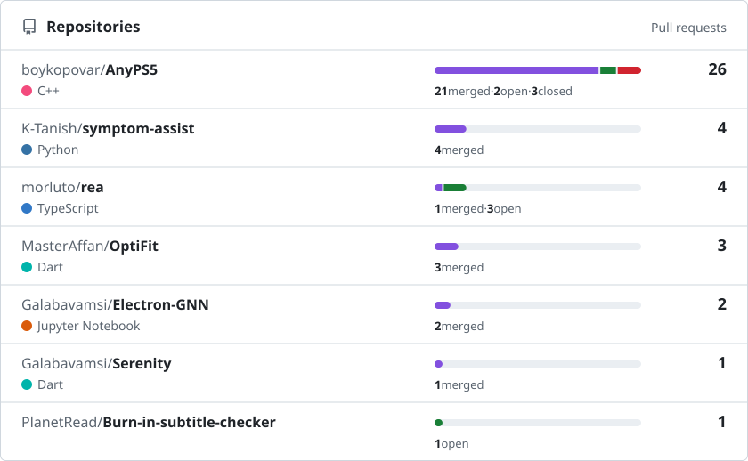

# Hi, I'm Paritosh 👋

Backend engineering • C++ • Go • Open Source

I enjoy building backend systems and exploring infrastructure, distributed systems, and open-source software.

## Open source

<!-- PR-DASHBOARD:START -->
<a href="https://github.com/search?type=pullrequests&amp;q=is%3Apr%20is%3Apublic%20author%3ASandstromPL%20-user%3ASandstromPL"><picture><source media="(prefers-color-scheme: dark)" srcset="assets/pr-dashboard/pr-summary-dark.svg"></picture></a>

<a href="https://github.com/search?type=pullrequests&amp;q=is%3Apr%20is%3Apublic%20author%3ASandstromPL%20-user%3ASandstromPL"><picture><source media="(prefers-color-scheme: dark)" srcset="assets/pr-dashboard/pr-repos-dark.svg"></picture></a>

<b>Recent pull requests</b> · latest 8 of 41

 

<table>
<tr><td><a href="https://github.com/morluto/rea/pull/6253"><picture><source media="(prefers-color-scheme: dark)" srcset="assets/pr-dashboard/pr-open-dark.svg"></picture></a></td><td><a href="https://github.com/morluto/rea/pull/6253">fix(doctor): check only the current platform&#x27;s Hopper launcher candidates</a> <a href="https://github.com/morluto/rea">morluto/rea</a>#6253 · opened Oct 22</td></tr>
<tr><td><a href="https://github.com/morluto/rea/pull/4642"><picture><source media="(prefers-color-scheme: dark)" srcset="assets/pr-dashboard/pr-open-dark.svg"></picture></a></td><td><a href="https://github.com/morluto/rea/pull/4642">fix(setup): offer Hopper installation only where setup can install it</a> <a href="https://github.com/morluto/rea">morluto/rea</a>#4642 · opened Oct 17</td></tr>
<tr><td><a href="https://github.com/morluto/rea/pull/4466"><picture><source media="(prefers-color-scheme: dark)" srcset="assets/pr-dashboard/pr-merged-dark.svg"></picture></a></td><td><a href="https://github.com/morluto/rea/pull/4466">feat(android): make the JADX operation deadline configurable</a> <a href="https://github.com/morluto/rea">morluto/rea</a>#4466 · merged Oct 16</td></tr>
<tr><td><a href="https://github.com/morluto/rea/pull/4430"><picture><source media="(prefers-color-scheme: dark)" srcset="assets/pr-dashboard/pr-open-dark.svg"></picture></a></td><td><a href="https://github.com/morluto/rea/pull/4430">fix(firmware): size the producer file limit above the report and staging budgets</a> <a href="https://github.com/morluto/rea">morluto/rea</a>#4430 · opened Oct 16</td></tr>
<tr><td><a href="https://github.com/PlanetRead/Burn-in-subtitle-checker/pull/28"><picture><source media="(prefers-color-scheme: dark)" srcset="assets/pr-dashboard/pr-open-dark.svg"></picture></a></td><td><a href="https://github.com/PlanetRead/Burn-in-subtitle-checker/pull/28">feat(module-2): multi-frame burned-in subtitle extraction with span-a…</a> <a href="https://github.com/PlanetRead/Burn-in-subtitle-checker">PlanetRead/Burn-in-subtitle-checker</a>#28 · opened May 14</td></tr>
<tr><td><a href="https://github.com/K-Tanish/symptom-assist/pull/101"><picture><source media="(prefers-color-scheme: dark)" srcset="assets/pr-dashboard/pr-merged-dark.svg"></picture></a></td><td><a href="https://github.com/K-Tanish/symptom-assist/pull/101">fixes: improved knowledge_graph weight addition and used normalizatio…</a> <a href="https://github.com/K-Tanish/symptom-assist">K-Tanish/symptom-assist</a>#101 · merged May 7</td></tr>
<tr><td><a href="https://github.com/K-Tanish/symptom-assist/pull/82"><picture><source media="(prefers-color-scheme: dark)" srcset="assets/pr-dashboard/pr-merged-dark.svg"></picture></a></td><td><a href="https://github.com/K-Tanish/symptom-assist/pull/82">feat: added automate github ci</a> <a href="https://github.com/K-Tanish/symptom-assist">K-Tanish/symptom-assist</a>#82 · merged May 3</td></tr>
<tr><td><a href="https://github.com/K-Tanish/symptom-assist/pull/55"><picture><source media="(prefers-color-scheme: dark)" srcset="assets/pr-dashboard/pr-merged-dark.svg"></picture></a></td><td><a href="https://github.com/K-Tanish/symptom-assist/pull/55">feat(ui): add resizable split pane for chat and diagnostics</a> <a href="https://github.com/K-Tanish/symptom-assist">K-Tanish/symptom-assist</a>#55 · merged Apr 26</td></tr>
</table>

<a href="https://github.com/search?type=pullrequests&amp;q=is%3Apr%20is%3Apublic%20author%3ASandstromPL%20-user%3ASandstromPL">See all 41 pull requests on GitHub →</a>

Public pull requests to other people&#x27;s repositories, drafts counted as open · refreshed automatically when PRs change · breakdowns cover the 9 most recent of 41.
<!-- PR-DASHBOARD:END -->
