# Hi, I'm Paritosh 👋

Final-year Computer Science student at **IIT Bhilai**. I build backend systems in **Go** and **C++** and contribute to open-source projects.

[LinkedIn](https://linkedin.com/in/paritosh-lahre-7a6648253) · [LeetCode](https://leetcode.com/u/sandstormPL/)

## Experience

**Open Source Mentee · Linux Foundation (LFX Mentorship) · Magma Core** · *May – Aug 2026*  
Deployed and debugged Magma Core, an open-source LTE/5G networking platform, locally with Go, Docker, gRPC and Protocol Buffers, and traced its end-to-end networking workflow with Wireshark, PacketRusher and UERANSIM.

## Open source

Merged fixes in projects like rea and AnyPS5, plus 7 pull requests during GirlScript Summer of Code 2025. The stats below update automatically within minutes of each PR.

<!-- PR-DASHBOARD:START -->
<a href="https://github.com/search?type=pullrequests&amp;q=is%3Apr%20is%3Apublic%20author%3ASandstromPL%20-user%3ASandstromPL"><picture><source media="(prefers-color-scheme: dark)" srcset="assets/pr-dashboard/pr-summary-dark.svg"></picture></a>

<a href="https://github.com/search?type=pullrequests&amp;q=is%3Apr%20is%3Apublic%20author%3ASandstromPL%20-user%3ASandstromPL"><picture><source media="(prefers-color-scheme: dark)" srcset="assets/pr-dashboard/pr-repos-dark.svg"></picture></a>

<b>Recent pull requests</b> · latest 8 in featured repositories

 

<table>
<tr><td><a href="https://github.com/meshery/meshery/pull/23655"><picture><source media="(prefers-color-scheme: dark)" srcset="assets/pr-dashboard/pr-open-dark.svg"></picture></a></td><td><a href="https://github.com/meshery/meshery/pull/23655">[Server] End SSE streams when the server starts shutting down</a> <a href="https://github.com/meshery/meshery">meshery/meshery</a>#23655 · opened Nov 15</td></tr>
<tr><td><a href="https://github.com/meshery/meshery/pull/23634"><picture><source media="(prefers-color-scheme: dark)" srcset="assets/pr-dashboard/pr-merged-dark.svg"></picture></a></td><td><a href="https://github.com/meshery/meshery/pull/23634">[Server] Stop the HTTP server timeouts from cutting off SSE streams and slow uploads</a> <a href="https://github.com/meshery/meshery">meshery/meshery</a>#23634 · merged Nov 15</td></tr>
<tr><td><a href="https://github.com/morluto/rea/pull/10310"><picture><source media="(prefers-color-scheme: dark)" srcset="assets/pr-dashboard/pr-open-dark.svg"></picture></a></td><td><a href="https://github.com/morluto/rea/pull/10310">fix(cutter): explain empty discovery when Cutter 2.5.0 rejects the plugin</a> <a href="https://github.com/morluto/rea">morluto/rea</a>#10310 · opened Nov 13</td></tr>
<tr><td><a href="https://github.com/morluto/rea/pull/7150"><picture><source media="(prefers-color-scheme: dark)" srcset="assets/pr-dashboard/pr-merged-dark.svg"></picture></a></td><td><a href="https://github.com/morluto/rea/pull/7150">fix(setup): replace the fixed Hopper download deadline with a stall timeout</a> <a href="https://github.com/morluto/rea">morluto/rea</a>#7150 · merged Nov 5</td></tr>
<tr><td><a href="https://github.com/morluto/rea/pull/4430"><picture><source media="(prefers-color-scheme: dark)" srcset="assets/pr-dashboard/pr-merged-dark.svg"></picture></a></td><td><a href="https://github.com/morluto/rea/pull/4430">fix(firmware): reject staged files cut off at the per-file limit</a> <a href="https://github.com/morluto/rea">morluto/rea</a>#4430 · merged Nov 4</td></tr>
<tr><td><a href="https://github.com/gofr-dev/gofr/pull/4579"><picture><source media="(prefers-color-scheme: dark)" srcset="assets/pr-dashboard/pr-open-dark.svg"></picture></a></td><td><a href="https://github.com/gofr-dev/gofr/pull/4579">fix(file): keep OpenFile(O_RDWR) off the app host for cloud stores, and stop Seek/ReadAt…</a> <a href="https://github.com/gofr-dev/gofr">gofr-dev/gofr</a>#4579 · opened Nov 3</td></tr>
<tr><td><a href="https://github.com/gofr-dev/gofr/pull/4578"><picture><source media="(prefers-color-scheme: dark)" srcset="assets/pr-dashboard/pr-open-dark.svg"></picture></a></td><td><a href="https://github.com/gofr-dev/gofr/pull/4578">fix(file): use the os package for the local store&#x27;s file operations (#4488)</a> <a href="https://github.com/gofr-dev/gofr">gofr-dev/gofr</a>#4578 · opened Nov 3</td></tr>
<tr><td><a href="https://github.com/morluto/rea/pull/8684"><picture><source media="(prefers-color-scheme: dark)" srcset="assets/pr-dashboard/pr-merged-dark.svg"></picture></a></td><td><a href="https://github.com/morluto/rea/pull/8684">fix(browser): keep negative script columns Chrome reports</a> <a href="https://github.com/morluto/rea">morluto/rea</a>#8684 · merged Nov 3</td></tr>
</table>

<a href="https://github.com/search?type=pullrequests&amp;q=is%3Apr%20is%3Apublic%20author%3ASandstromPL%20-user%3ASandstromPL">See all 57 pull requests on GitHub →</a>

Public pull requests to other people&#x27;s repositories, drafts counted as open · refreshed automatically when PRs change.
<!-- PR-DASHBOARD:END -->

## Hackathons

| Hackathon | What I built | Result |
|---|---|---|
| **HackerRank Orchestrate** Oct 2026 · 24 hours | [Deletion-audit agent](https://github.com/SandstromPL/hackerrank-orchestrate-october26-final) for the *Ghost Data Still Exists* challenge: checks whether a person's data was really erased across every record and data flow, with deterministic code making the decisions and a model handling only the judgments parsing can't | 🏅&nbsp;**#135**&nbsp;of&nbsp;4,094 top 4% |
| **Qloo Agentic Hackathon** Nov 2026 | [itsgiving](https://github.com/SandstromPL/itsgiving): an agent for music-video and short-film directors that turns an audience's taste on Qloo into a pitch deck, with the evidence behind every pick [Live demo](https://itsgiving-two.vercel.app) · [Devpost](https://devpost.com/software/itsgiving) | Submitted |

## Projects

| Project | What it does | Built with |
|---|---|---|
| [Redis Clone](https://github.com/SandstromPL/OWN-REDIS) | Redis-like server speaking RESP over TCP, with string and hash commands and AOF persistence | Go |
| [ScaleURL](https://github.com/SandstromPL/url-shortner) | URL shortener with analytics, expiry and rate limiting; cache-aside reads and async click logging | Go, PostgreSQL, Redis, Docker, JWT |
| [Warehouse Robot Simulator](https://github.com/SandstromPL/Multi-Agent-Warehouse-Robot-Simulator) | 25+ robots planning live paths with A*, BFS, CSP, Minimax and hill climbing | Python |

## Tech

**Languages:** C/C++ · Go · Python · SQL  
**Backend:** REST APIs · FastAPI · gRPC · Protocol Buffers  
**Databases:** PostgreSQL · MongoDB · Redis  
**Tools:** Linux · Docker · Git · GitHub Actions · Bash

🎬 Off the keyboard I act and make films: 1st place in Film Making and Stage Play at Anveshan 2026.
