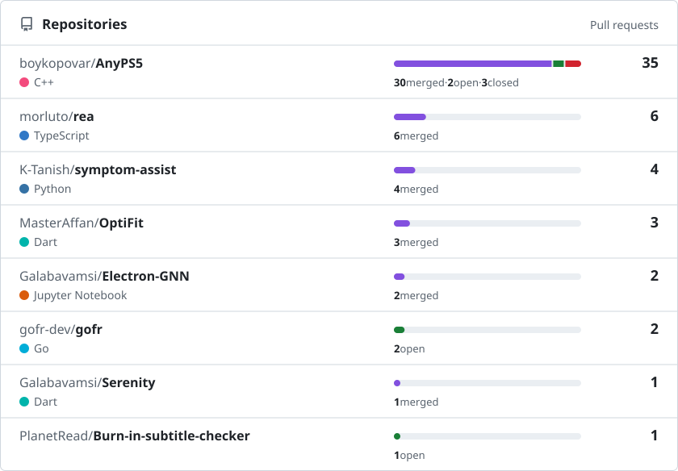

# Hi, I'm Paritosh 👋

Backend engineering • C++ • Go • Open Source

I enjoy building backend systems and exploring infrastructure, distributed systems, and open-source software.

## Open source

<!-- PR-DASHBOARD:START -->
<a href="https://github.com/search?type=pullrequests&amp;q=is%3Apr%20is%3Apublic%20author%3ASandstromPL%20-user%3ASandstromPL"><picture><source media="(prefers-color-scheme: dark)" srcset="assets/pr-dashboard/pr-summary-dark.svg"></picture></a>

<a href="https://github.com/search?type=pullrequests&amp;q=is%3Apr%20is%3Apublic%20author%3ASandstromPL%20-user%3ASandstromPL"><picture><source media="(prefers-color-scheme: dark)" srcset="assets/pr-dashboard/pr-repos-dark.svg"></picture></a>

<b>Recent pull requests</b> · latest 8 of 52

 

<table>
<tr><td><a href="https://github.com/morluto/rea/pull/7150"><picture><source media="(prefers-color-scheme: dark)" srcset="assets/pr-dashboard/pr-merged-dark.svg"></picture></a></td><td><a href="https://github.com/morluto/rea/pull/7150">fix(setup): replace the fixed Hopper download deadline with a stall timeout</a> <a href="https://github.com/morluto/rea">morluto/rea</a>#7150 · merged Nov 5</td></tr>
<tr><td><a href="https://github.com/morluto/rea/pull/4430"><picture><source media="(prefers-color-scheme: dark)" srcset="assets/pr-dashboard/pr-merged-dark.svg"></picture></a></td><td><a href="https://github.com/morluto/rea/pull/4430">fix(firmware): reject staged files cut off at the per-file limit</a> <a href="https://github.com/morluto/rea">morluto/rea</a>#4430 · merged Nov 4</td></tr>
<tr><td><a href="https://github.com/boykopovar/AnyPS5/pull/11002"><picture><source media="(prefers-color-scheme: dark)" srcset="assets/pr-dashboard/pr-merged-dark.svg"></picture></a></td><td><a href="https://github.com/boykopovar/AnyPS5/pull/11002">fix(libkernel): let a guest ignore or catch SIGPIPE on Linux</a> <a href="https://github.com/boykopovar/AnyPS5">boykopovar/AnyPS5</a>#11002 · merged Nov 3</td></tr>
<tr><td><a href="https://github.com/gofr-dev/gofr/pull/4579"><picture><source media="(prefers-color-scheme: dark)" srcset="assets/pr-dashboard/pr-open-dark.svg"></picture></a></td><td><a href="https://github.com/gofr-dev/gofr/pull/4579">fix(file): keep OpenFile(O_RDWR) off the app host for cloud stores, and stop Seek/ReadAt…</a> <a href="https://github.com/gofr-dev/gofr">gofr-dev/gofr</a>#4579 · opened Nov 3</td></tr>
<tr><td><a href="https://github.com/gofr-dev/gofr/pull/4578"><picture><source media="(prefers-color-scheme: dark)" srcset="assets/pr-dashboard/pr-open-dark.svg"></picture></a></td><td><a href="https://github.com/gofr-dev/gofr/pull/4578">fix(file): use the os package for the local store&#x27;s file operations (#4488)</a> <a href="https://github.com/gofr-dev/gofr">gofr-dev/gofr</a>#4578 · opened Nov 3</td></tr>
<tr><td><a href="https://github.com/morluto/rea/pull/8684"><picture><source media="(prefers-color-scheme: dark)" srcset="assets/pr-dashboard/pr-merged-dark.svg"></picture></a></td><td><a href="https://github.com/morluto/rea/pull/8684">fix(browser): keep negative script columns Chrome reports</a> <a href="https://github.com/morluto/rea">morluto/rea</a>#8684 · merged Nov 3</td></tr>
<tr><td><a href="https://github.com/boykopovar/AnyPS5/pull/13616"><picture><source media="(prefers-color-scheme: dark)" srcset="assets/pr-dashboard/pr-merged-dark.svg"></picture></a></td><td><a href="https://github.com/boykopovar/AnyPS5/pull/13616">test(videoout): register the nine flip-test modes that never ran</a> <a href="https://github.com/boykopovar/AnyPS5">boykopovar/AnyPS5</a>#13616 · merged Oct 31</td></tr>
<tr><td><a href="https://github.com/boykopovar/AnyPS5/pull/13615"><picture><source media="(prefers-color-scheme: dark)" srcset="assets/pr-dashboard/pr-merged-dark.svg"></picture></a></td><td><a href="https://github.com/boykopovar/AnyPS5/pull/13615">fix(tools): stop listing opcodes counted through their variants as uncounted</a> <a href="https://github.com/boykopovar/AnyPS5">boykopovar/AnyPS5</a>#13615 · merged Oct 31</td></tr>
</table>

<a href="https://github.com/search?type=pullrequests&amp;q=is%3Apr%20is%3Apublic%20author%3ASandstromPL%20-user%3ASandstromPL">See all 52 pull requests on GitHub →</a>

Public pull requests to other people&#x27;s repositories, drafts counted as open · refreshed automatically when PRs change.
<!-- PR-DASHBOARD:END -->
